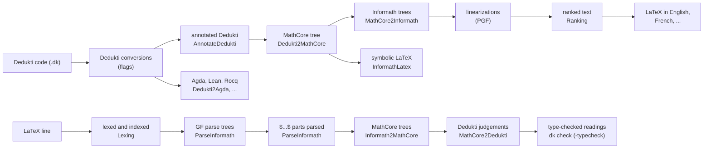
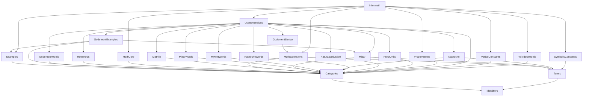
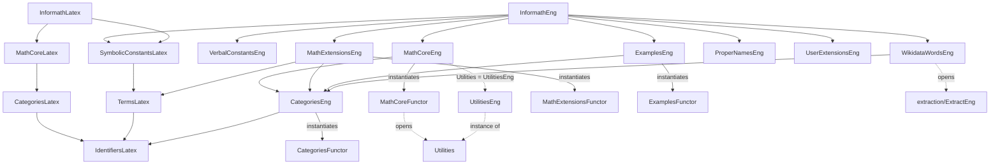

# The Phases of Informalization in Informath: a Walk through the Code

This report follows the top-level code of Informath, the module
[InformathAPI](../src/InformathAPI.hs), and shows which pieces of code produce
each phase of the conversions. It links to the underlying files for the
details. It describes the code as of commit `ce5c8f6` (October 2026).

The report has three main parts:

1. how the environment `Env` is built by `readEnv`, and the most important
   choices made there;
2. how `processJmt` takes a Dedukti judgement to LaTeX in a natural language
   (*informalization*);
3. how `processLatexLine` takes a line of LaTeX to Dedukti (*formalization*).

It ends with a list of the Haskell and GF files and diagrams of their
dependencies. For the theory behind the phases, see
[Informath under the Hood](./informath-under-the-hood.md); for using the
system, see the [README](../README.md).

All examples below were produced with `RunInformath` built from this commit,
with the default English grammar and symbol table.


## Overview



The two directions share one environment, `Env`, built once by `readEnv` from
the command-line flags: the GF grammar, the symbol tables and the options
that steer every phase.


## 1. The environment: `readEnv`

[`readEnv`](../src/InformathAPI.hs) turns a list of flags into an `Env`, the
record defined in [Environment.hs](../src/Environment.hs). Most functions of
the API take an `Env` as their first argument. `RunInformath` builds it once
in its `main` ([RunInformath.hs](../app/RunInformath.hs)), and an API user can
call `readEnv []` to get the defaults.

```haskell
data Env = Env {
  flags :: [Flag],                 -- the flags themselves, consulted with isFlag
  informathRoot :: String,         -- $INFORMATH_ROOT
  grammar :: PGF,                  -- the GF grammar
  baseConstantModule :: Module,    -- the Dedukti base (-base)
  symbolTable :: SymbolTable,      -- the .dkgf files, compiled
  reachableFunctions :: Set.Set CId,
  formalisms :: [String],
  langs :: [Language],             -- the languages ranked and shown
  toLang, fromLang, symbolTableLang :: Language,
  toFormalism :: String,
  nbestNLG :: Maybe Int,
  scoreWeights :: [Int],
  samplingFactor :: Int,
  morpho :: Morpho                 -- for recognizing the words of the grammar
  }
```

The steps of `readEnv`, with the choices made in each:

1. **The root.** Every file is found relative to the environment variable
   `INFORMATH_ROOT` (`informathRootVar`). It is read with `getEnv` and has no
   default, so `readEnv` fails if the variable is not set.

2. **The Dedukti base.** `-base=<files>` gives the Dedukti modules whose
   constants the input uses, by default
   [share/baseconstants.dk](../share/baseconstants.dk). It is parsed by
   `readDeduktiModule` with the BNFC parser of
   [src/typetheory/Dedukti.bnf](../src/typetheory/Dedukti.bnf). The base is
   needed by proof texts (`-proof-text`), type checking (`-typecheck`) and
   checking the symbol table (`-check-constant-table`).

3. **The grammar.** `grammarFile` chooses between two compiled grammars:
   `share/InformathEng.pgf`, with English and the symbolic LaTeX notation only,
   and `share/InformathFull.pgf`, with all languages. The full grammar is
   chosen as soon as any of `-from-lang`, `-to-lang`, `-symboltable-lang` or
   `-languages` names a language other than English. The English grammar is
   much smaller and faster to load. `-grammar=<file>.pgf` overrides the
   choice. The `.pgf` files are compiled from [grammars/](../grammars) by the
   [Makefile](../Makefile) (`make share/InformathEng.pgf`, `make full_grammar`).

4. **The symbol tables.** The symbol tables (`.dkgf` files) map Dedukti
   constants to GF functions. With `-symboltables=<files>` the given tables
   *replace* the default [share/baseconstants.dkgf](../share/baseconstants.dkgf);
   with `-add-symboltables=<files>` they are *added* to it. All the tables are
   read as one list of lines, so a later entry for a constant overrides an
   earlier one.

5. **The language of the symbol tables.** An entry can be written as an
   example phrase in quotes, which is parsed with the grammar. The language of
   the examples is `-symboltable-lang` (default English); one language serves
   for all tables.

6. **Building the symbol table.** `readSymbolTable` calls
   [`buildSymbolTable`](../src/BuildConstantTable.hs), which sorts the lines
   into the tables of the `SymbolTable` record:

   | line | table | used in |
   |---|---|---|
   | `c : f \| "example" \| $\latex$` | `constantTable`, `backConstantTable`, part of `macroTable` | annotation, and the way back to Dedukti |
   | `#CONV agda c c'` | `conversionTable` | names in Agda, Lean, Rocq |
   | `#DROP c n` | `dropTable`, `showTable` | hiding the first n arguments; proof texts |
   | `#SHOW c [i,j]` | `showTable` | the premisses of a rule in a proof text |
   | `#MACRO \newcommand...` | `macroTable` | `\newcommand`s of the LaTeX output |
   | `#BUILTIN c ...` | `builtinSet` | constants handled by the code |
   | `#IMPLICIT A` | `implicitTypes` | variables of type A left unsaid |
   | `#SEMANTICS f = ...` | `semanticsTable` | user-defined semantics in parsing |
   | `#NLG f = ...` | `nlgTable` | user-defined variants in generation |

   For a constant entry, the first form is the *primary* one. The others are
   *symbolic* forms (those of a symbolic category, such as the `$...$` forms
   and `Oper2` functions) and *synonyms* (verbal forms). An example in quotes
   is parsed into a function with an argument profile (`parseFunProfile`,
   `parseExample`): which arguments of the Dedukti constant go where in the
   GF tree. Each `$...$` form becomes a LaTeX macro of its own. The
   `backConstantTable` inverts the `constantTable`: from each GF function to
   the Dedukti constants it can come from.

7. **Reachable functions.** `reachableGFFunctions` collects the GF functions
   that some symbol table entry reaches. In parsing, a tree that uses a
   lexical function outside this set is rejected as *spurious*: its words are
   in the grammar, but no Dedukti constant corresponds to them.

8. **The languages.** `langs` is the list of languages in which results are
   ranked and shown: those of `-languages=Eng,Fre,...`, or else all the
   concrete syntaxes of the grammar except `InformathLatex`, which is a
   notation rather than a language. `toLang` (`-to-lang`) is the language of
   plain text output, `fromLang` (`-from-lang`) the language parsed.

9. **Options for generation.**
   - `-nbest=<n>` gives `nbestNLG`, the number of results per language;
   - `-weights=<ints>` gives `scoreWeights`, the weights of the ranking
     scores;
   - `-sampling=<n>` (default 2) gives `samplingFactor`: only every n-th
     variant is kept.

10. **Morphology.** `morpho` is the morphological analyser of the grammar in
    `fromLang`. In parsing, it tells a user macro (`\foo`) from a symbol of
    the grammar itself (`\times`).

With `-check-constant-table`, `readEnv` also reports the mismatches between
the base module, the grammar and the symbol table (`checkSymbolTable`).


## 2. From Dedukti to a natural language: `processJmt`

### The path through RunInformath

For a `.dk` file, `main4` in [RunInformath.hs](../app/RunInformath.hs) does:

```haskell
mo <- readDeduktiModule [file]
let results = processDeduktiModule env mo
mapM_ putStrLn (printResults env (concatMap (printGenResult env) results))
```

`processDeduktiModule` applies `processJmt` to each judgement of the module.
`processJmt` returns a `GenResult`, which keeps the intermediate phases for
debugging:

```haskell
data GenResult = GenResult {
  originalDedukti  :: Jmt,
  annotatedDedukti :: [Jmt],
  coreGF           :: [GFTree],
  nlgResults       :: [(Language, [((GFTree, String), (Scores, Int))])],
  backToDedukti    :: [Jmt]
  }
```

`-json` (or `-v`) prints all of them. The running example of this section is

```
prop20 : (n : Elem Nat) -> Proof (even n) -> Proof (odd (plus n 1)).
```

which comes out as

```
Prop20. Let $n$ be an even natural number. Then $n + 1$ is odd.
Prop20. Soit $n$ un nombre naturel pair. Alors $n + 1$ est impair.     (-to-lang=Fre)
```

### 2.1 Conversions within Dedukti

`applyDeduktiConversions` applies the conversions that the flags select, all
defined in [DeduktiOperations.hs](../src/DeduktiOperations.hs):

- `-peano2int`: `succ (succ 0)` as `2`;
- `-drop-qualifs`: no module qualifiers;
- `-drop-definitions`: only the types of definitions;
- `-hide-arguments`: the first arguments of a constant hidden, as `#DROP`
  says.

If the target is a formalism (`-to-formalism=agda`, `lean`, `rocq` or
`dedukti`), the work ends here. `dummyGenResult` keeps the judgement, and
`printFormalismJmt` translates it with [Dedukti2Agda](../src/Dedukti2Agda.hs),
[Dedukti2Lean](../src/Dedukti2Lean.hs) or [Dedukti2Rocq](../src/Dedukti2Rocq.hs),
renaming the constants as the `#CONV` lines say. No GF is needed.

### 2.2 Implicit hypotheses

[`dropImplicitHypos`](../src/ProofText.hs) removes the leading hypotheses of a
statement whose type the symbol table declares `#IMPLICIT`. For example, with
`#IMPLICIT Elem Obj`, "let $x$ be a mathematical object" is not said. In a
definition, the variables cannot be dropped, because the definiendum applies
the constant to them. `implicitPositions` records where they are, and
`Dedukti2MathCore.hideHypoVars` later leaves them unsaid in the MathCore tree.
`-show-implicit-hypotheses` turns all of this off.

### 2.3 Annotation: `annotateDedukti`

```haskell
annotateDedukti env t = annotateDkIdents env (harmonizeJmt t)
```

Both functions are in [AnnotateDedukti.hs](../src/AnnotateDedukti.hs).

- **`harmonizeJmt`** turns every judgement into a `def` with named hypotheses
  that agree with the variables of the definiens. An unnamed hypothesis gets a
  name (`y` below). A hypothesis that is a function into proofs, a derived rule
  taken as a premiss, is read as the proof of the proposition it amounts to.
- **`annotateDkIdents`** replaces each constant by an annotated identifier.
  The identifier names the GF category and function that the symbol table
  gives it, the categories of its arguments, and its profile:
  `constant#Cat#function#argument categories#profile`.

  A constant with several forms (a primary form, symbolic forms, synonyms)
  gives several annotated judgements, one for each combination. The example
  gives four, since `Nat` can be `\Natural` or "natural number" and `plus` can
  be `+` or "the sum of":

```
def prop20 : (n : Elem#Kind#ElemKind#Kind# Nat#MACRO#'\\Natural'#)
  -> y : Proof#Prop#ProofProp#Prop# (even#Adj#even_Adj# n)
  -> Proof#Prop#ProofProp#Prop# (odd#Adj#odd_Adj# (plus#Oper2#plus_Oper2# n 1)) .
def prop20 : (n : Elem#Kind#ElemKind#Kind# Nat#Noun#natural_Noun#) -> ...
  (odd#Adj#odd_Adj# (plus#FunC#plus_FunC# n 1)) .
...
```

The flags choose among the combinations:

- `-synonyms=<n>` and `-symbolics=<n>` limit how many forms of each kind are
  used; without `-variations` only the first of each is used.
- `-force-symbolic` uses the symbolic forms only.
- `-to-symbolic-latex` uses the symbolic forms, or else the core functions
  (`symbolicLatexId`).
- `-max-annotations=<k>` (default 256) bounds the number of alternatives per
  subtree. They are counted by *verbality*, the number of verbal constants.
  The most symbolic, the most verbal and some between them are kept.

Finally, `checkSymbolics` removes the alternatives that put a verbal phrase
inside a symbolic formula: `$n + $ the successor of $m$` would not be a
formula.

### 2.4 From Dedukti to MathCore: `dedukti2core`

[`Dedukti2MathCore.jmt2core`](../src/Dedukti2MathCore.hs) translates each
annotated judgement into a tree of MathCore, the minimal abstract syntax of
[grammars/MathCore.gf](../grammars/MathCore.gf):

```haskell
jmt2core = cleanup . jmt2jmt . introduceLocalDefinitions
```

- **`introduceLocalDefinitions`** turns `let`-bound definitions in a type
  into hypotheses.
- **`jmt2jmt`** chooses the kind of judgement from the category of the
  constant: a theorem or axiom (`ThmJmt`, `AxiomJmt`), a definition of an
  expression, a proposition or a kind (`DefExpJmt`, `DefPropJmt`,
  `DefKindJmt`), and so on. Where the symbol table does not say the category,
  `guessGFCat` guesses it from the type. It translates the hypotheses
  (`hypos2hypos`), propositions (`exp2prop`), kinds (`exp2kind`),
  expressions (`exp2exp`) and proofs (`exp2proof`) by the annotations:
  `even#Adj#even_Adj#` becomes `AdjProp even_Adj x`.
- **Special constants:** constants outside the lexical categories, such as
  binders and the logical constants, are handled through the callbacks of
  [SpecialConstants.hs](../src/SpecialConstants.hs).
- **`cleanup`** strips what is left of the annotations from the identifiers.

The GF trees are values of the Haskell datatype `Tree` of
[Informath.hs](../src/Informath.hs), which GF generates from the grammar
(`make share/InformathEng.pgf`). The first of the four MathCore trees of the
example:

```
AxiomJmt (IdentLabel (StrIdent "prop20"))
  (ConsHypo (VarsHypo (BaseIdent (StrIdent "n")) (ElemKind (ExpKind (TermExp (MacroTerm (StringMacro "\\Natural"))))))
  (ConsHypo (PropVarHypo (StrIdent "y") (ProofProp (AdjProp even_Adj (TermExp (IdentTerm (StrIdent "n"))))))
   BaseHypo))
  (ProofProp (AdjProp odd_Adj (TermExp (Oper2Term plus_Oper2 (IdentTerm (StrIdent "n")) (IdentTerm (StrIdent "1"))))))
```

MathCore says everything, in one way: "Let $n$ be an element of $\Natural$.
Assume that $n$ is even. Then $n + 1$ is odd." The next phase finds the other
ways.

### 2.5 From MathCore to Informath: `core2ext`

`core2ext` is [`MathCore2Informath.nlg`](../src/MathCore2Informath.hs). It
rewrites a MathCore tree into trees of the full Informath grammar
([grammars/Informath.gf](../grammars/Informath.gf)), which has many ways to say
the same thing. The passes, in order:

| pass | what it does |
|---|---|
| `unparenth` | binary `CoreAndProp` etc. as lists: "A and B and C" |
| `uncoerce` | drops the coercions `ProofProp`, `ElemKind` |
| `flatten` | nested conjunctions and disjunctions as one list |
| `aggregate` | "Let $n$ be a natural number. Assume that $n$ is even." as "Let $n$ be an even natural number."; "$x$ is even and $y$ is even" as "$x$ and $y$ are even" |
| `insitu` | quantifiers in place: "every natural number is ..." |
| `varless` | quantifiers without unused variables |
| `collectivize` | collective predicates: "$x$ and $y$ are distinct" |
| `negated` | negations into the predicate: "$n$ is not even" |
| `implied` | implications between propositional formulas as "$A$ implies $B$" |
| `scoped` | "both ... and", "either ... or", where the scope needs it |
| `variations` | variants of the whole judgement (with `-more-variants`) |

By default the result is the output of `scoped . implied . negated` on all
the collectivized trees. With `-more-variants`, the trees of every pass,
the `variations`, and the user variants of `#NLG` lines (`appNLGDefs` of
[Semantics.hs](../src/Semantics.hs)) are added. Of the trees, every n-th is
kept (`-sampling`). Two flags change the passes:

- `-mathcore` keeps the MathCore tree only;
- `-godement` uses the Godement-style variants of
  [GodementNLG.hs](../src/GodementNLG.hs) instead.

After the passes, `MathCore2Informath.bareQuantifiers` drops the kinds of the
quantifiers over implicit types: "for all $x$" instead of "for all
mathematical objects $x$".

### 2.6 Linearization and ranking

Each Informath tree is linearized in each language of `langs` by
`gftree2nat`, a call of the PGF linearizer. The concrete syntaxes write
formulas in LaTeX within `$...$`. `unlex` (`Lexing.unlextex`) puts the tokens
together, unless `-no-unlex` is given.

[Ranking.hs](../src/Ranking.hs) scores each (tree, text) pair and sorts by the
weighted sum of the scores, lowest first (`-no-ranking` leaves them unsorted):

- the size and depth of the tree;
- the number of characters and tokens;
- `$...$` parts that follow each other, and sentences that start with one;
- with `-test-ambiguity`, the number of extra parses of the text.

The weights come from `-weights`. Only the best result is kept, unless
`-nbest=<n>` or `-variations` asks for more. The best English result of the
example scored 116:

```
AxiomJmt (IdentLabel (StrIdent "prop20"))
  (ConsHypo (AdjKindHypo (BaseIdent (StrIdent "n")) even_Adj (NounKind natural_Noun)) BaseHypo)
  (AdjProp odd_Adj (TermExp (Oper2Term plus_Oper2 (IdentTerm (StrIdent "n")) (IdentTerm (StrIdent "1")))))

Prop20. Let $n$ be an even natural number. Then $n + 1$ is odd.
```

### 2.7 Back to Dedukti, for checking

`backToDedukti` translates the Informath trees back to Dedukti with the
functions of part 3 (`gjmt2dedukti`). It is a check of the round trip. In
the example it gives three judgements:

```
prop20 : n : Elem Nat -> Proof (even n) -> Proof (odd (plus n 1)) .
prop20 : n : Elem Nat -> Proof (even n) -> Proof (odd (plus n (nd 1))) .
prop20 : n : Elem Nat -> Proof (even n) -> Proof (odd (vectorPlus n 1)) .
```

The first is the original. The others show two ambiguities: `1` read as a
digit (`nd 1`), and `+` as the addition of vectors, which shares the symbol.
`-no-back-to-dedukti` leaves the round trip out.

### 2.8 Printing

`printGenResult` chooses the output format by the flags:

- **`-to-formalism=<f>`:** the formal translation of 2.1.
- **`-to-symbolic-latex`:** `printSymbolicLatex` linearizes the MathCore
  trees (`coreGF`) with the concrete syntax `InformathLatex`, which covers
  MathCore and the symbolic constants only. It writes standard logical
  notation: `$n \in \Natural , \mathrm{even} (n)\vdash \mathrm{odd} (n + 1)$`.
- **`-json`, `-v`, `-vs`:** all the phases as JSON (`showJsonGenResult`).
- **`-parallel-data`:** the data for training, one line per judgement.
- **Default:** `printNLGOutput` prints the best texts in `toLang`, and with
  `-trees` their GF trees.

`printResults` then prints the lines one by one. With `-to-latex-doc`, it
wraps them into a LaTeX document whose preamble has the `\newcommand`s of the
`macroTable` (`Utils.toLatexDoc`, `BuildConstantTable.macroCommands`).

### 2.9 Proof texts

Proofs take a separate path. With `-proof-text`, `RunInformath` calls
`showProofDemo`, which hands each proof to [ProofText.hs](../src/ProofText.hs).
There, `proofLines` turns the proof term into numbered lines in the style of
Jaśkowski and Fitch, with Dedukti formulas. Only after that does
`dkline2unitline` put each line into words with the proof units of
[grammars/ProofUnits.gf](../grammars/ProofUnits.gf): the statements of the
lines go through `exp2prop` of 2.4. `-proof-text-dedukti` shows the lines
with the Dedukti formulas. `-tactic-proof` (`showTacticProofs`) reads proofs
given as lists of units in JSON.


## 3. From LaTeX to Dedukti: `processLatexLine`

### The path through RunInformath

For a `.tex`, `.txt` or `.md` file, `main4` does:

```haskell
results <- typecheckParseResults env (processLatex env s)
mapM_ putStrLn (printResults env (concatMap (printParseResult env) results))
```

`processLatex` removes the `%` comments and applies `processLatexLine` to each
line that is not empty: **a line is the unit of parsing**. The result is a
`ParseResult`, again with all the intermediate phases:

```haskell
data ParseResult = ParseResult {
  originalLine, lexedLine :: String,
  termIndex :: [String],
  indexedLine, parseMessage :: String,
  unknownWords :: [String],
  parseResults, unindexedResults :: [GFTree],
  formalResults :: [(GFTree, GFTree, GFTree, [Jmt])],  -- parsed, unindexed, MathCore, Dedukti
  transResults :: [String],
  typecheckMessage :: String
  }
```

The running example is the sentence generated in part 2:

```
Let $n$ be an even natural number. Then $n + 1$ is odd.
```

### 3.1 Lexing and indexing

[`Lexing.lextex`](../src/Lexing.hs) splits the line into tokens, the text
and the `$...$` parts each in their own way:

```
let  $ n $ be an even natural number . then  $ n + 1 $ is odd .
```

`indexTex` replaces each `$...$` part with more than one token by
`\INDEXEDTERM { i }`, and keeps the part in the term index. A part of one
token, such as `$ n $`, stays in place, as the grammar parses it as a variable:

```
let $ n $ be an even natural number . then \INDEXEDTERM { 0 } is odd .      termIndex: ["$ n + 1 $"]
```

The formulas are parsed separately (3.3). Otherwise the ambiguities of the
text and of the formulas would multiply.

`unknownWords` (`missingWords`) lists the words of the line that the grammar
does not know.

### 3.2 Parsing: `parseJmt`

[`ParseInformath.parseJmt`](../src/ParseInformath.hs) parses the indexed line
in the category `Jmt` of the language `fromLang`, with the PGF parser. Of the
trees (at most 1999 are looked at):

- the *spurious* ones are dropped, those with a lexical function that no
  symbol table entry reaches (`isSpurious`, see `reachableFunctions` in part
  1); `-include-unreachable` keeps them;
- so are the trees whose variables or macros are ill-formed
  (`checkVariables`);
- the rest are sorted by depth, and the 19 shallowest are kept.

`parseMessage` says how it went: `# SUCCESS 9` (nine trees), or
`# FAILURE AT ...`. One of the nine trees of the example:

```
AxiomJmt noLabel (ConsHypo (AdjKindHypo (BaseIdent (StrIdent "n")) even_Adj (NounKind natural_Noun)) BaseHypo)
  (AdjProp odd_Adj (IndexedTermExp 0))
```

### 3.3 Parsing the formulas: `unindexGFTrees`

`unindexGFTrees` replaces each indexed part by the trees of the formula it
stands for: `IndexedTermExp i` is parsed as an `Exp`, `IndexedFormulaProp i`
as a `Prop`, and the parts that declare variables as a `Formula` or a
`Declaration`. All combinations of their readings are tried, at most 50. In
the example, `$ n + 1 $` becomes
`TermExp (Oper2Term plus_Oper2 (IdentTerm (StrIdent "n")) (NumberTerm 1))`.

### 3.4 From Informath to MathCore: `ext2core`

`ext2core` is [`Informath2MathCore.semantics`](../src/Informath2MathCore.hs),
the inverse of the passes of 2.5. It takes the many ways of saying a thing to
the one way of MathCore:

```haskell
semantics defs =
  concatMap (inSituResults . addCoercions . addParenth . sem initSEnv . godementSem)
  . godementExpand . removeFonts . appSemDefs defs
```

| step | what it does |
|---|---|
| `appSemDefs` | the user-defined semantics of `#SEMANTICS` lines ([Semantics.hs](../src/Semantics.hs)) |
| `removeFonts` | font commands in formulas left out |
| `godementExpand`, `godementSem` | Godement's constructions ("resp.", namings) in MathCore terms ([GodementSemantics.hs](../src/GodementSemantics.hs)) |
| `sem` | the main semantics: aggregated hypotheses, plurals, adjectives on kinds, negated predicates, ... back to MathCore |
| `addParenth` | lists of propositions as binary `CoreAndProp`, ... |
| `addCoercions` | `ProofProp` and `ElemKind` put back |
| `inSituResults` | quantifiers in place ("every $x$ is ...") taken out to scope, with Cooper storage; one result for each scoping |

The example gives back the MathCore tree of 2.4, with the hypotheses separated
again:

```
AxiomJmt noLabel
  (ConsHypo (VarsHypo (BaseIdent (StrIdent "n")) (ElemKind (NounKind natural_Noun)))
  (ConsHypo (PropHypo (ProofProp (AdjProp even_Adj (TermExp (IdentTerm (StrIdent "n")))))) BaseHypo))
  (ProofProp (AdjProp odd_Adj (TermExp (Oper2Term plus_Oper2 (IdentTerm (StrIdent "n")) (NumberTerm 1)))))
```

### 3.5 From MathCore to Dedukti: `gjmt2dedukti`

[`MathCore2Dedukti.jmt2dedukti`](../src/MathCore2Dedukti.hs) translates the
MathCore tree into Dedukti:

```haskell
jmt2dedukti lb dt =
  map eliminateLocalDefinitions . map (restoreFirstArguments dt)
  . filterNoUndefined . applyLookBack lb . jmt2jmt
```

- **`jmt2jmt`** is the inverse of the translation of 2.4.
- **`applyLookBack`** turns each GF function back into the Dedukti constants
  that the `backConstantTable` gives it, with their profiles. This is where
  the ambiguity of the words is resolved into readings: `plus_Oper2` can be
  `plus` or `vectorPlus`.
- **`filterNoUndefined`** drops the results with constructions that have no
  translation (`_UNDEFINED_...`), if there are any results without them.
- **`restoreFirstArguments`** gives back the arguments that `#DROP` hid.
- **`eliminateLocalDefinitions`** turns local definitions back into `let`.

The nine parses of the example give 14 different judgements. Some of them still have
`_UNDEFINED_` parts, because `filterNoUndefined` keeps a parse's readings that
have them when the parse has no others. The first parse gives:

```
noLabel : n : Elem Nat -> Proof (even n) -> Proof (odd (vectorPlus n (nd 1))) .
noLabel : n : Elem Nat -> Proof (even n) -> Proof (odd (plus n (nd 1))) .
```

### 3.6 Type checking

With `-typecheck`, `typecheckParseResults` keeps only the readings that
Dedukti's type checker `dk check` accepts on top of the base (`-base`). If no
reading of a line type-checks, all of them are kept, marked as ill-typed. Of
the 14 readings of the example, one is left:

```
noLabel : n : Elem Nat -> Proof (even n) -> Proof (odd (plus n (nd 1))) .
```

### 3.7 Printing and other uses of the parser

`printParseResult` chooses the output by the flags:

- **Default:** the Dedukti judgements (`printDeduktiOutput`).
- **`-to-formalism=<f>`:** the judgements translated as in 2.1.
- **`-json` or `-v`:** all the phases.
- **`-parse-only`:** the GF trees.
- **`-failures`, `-results`:** a report of which lines parse.
- **`-translate`:** translation between natural languages. The parse trees
  are linearized in `toLang`, and their formulas are kept as they are in the
  term index.
- **`-translate-core`:** each line followed by the verbalizations of its
  MathCore semantics, a way to see what a sentence is understood to mean.


## 4. The files

### Haskell files

The executable `RunInformath` is built from [app/](../app) and [src/](../src)
by `stack build` ([informath.cabal](../informath.cabal)).

| file | role |
|---|---|
| [app/RunInformath.hs](../app/RunInformath.hs) | The command-line program: the flags and their help text, and the choice of the conversion by the input file's suffix (`.dk`, `.tex`, `.dkgf`, `.gft`, `.json`, ...). |
| [src/InformathAPI.hs](../src/InformathAPI.hs) | The top-level API, followed in this report: `readEnv`, `processJmt`, `processLatexLine`, the printing of results, and smaller tools (statistics, symbol table checks). |
| [src/Environment.hs](../src/Environment.hs) | The `Env` record and the reading of flags (`isFlag`, `argValue`, ...); debugging traces (`-debug`). |
| [src/BuildConstantTable.hs](../src/BuildConstantTable.hs) | Reading the symbol tables (`.dkgf`) into a `SymbolTable`: constant entries, examples parsed into GF functions with profiles, the directives (`#DROP`, `#MACRO`, `#IMPLICIT`, ...), the backward table, the LaTeX macros. |
| [src/CommonConcepts.hs](../src/CommonConcepts.hs) | The GF categories that symbol tables use, with their arities and kinds (verbal, symbolic, proof); decoding annotated identifiers (`lookupConstant`). |
| [src/DeduktiTheoryAPI.hs](../src/DeduktiTheoryAPI.hs) | The identifiers of the base constants that the code refers to (`Elem`, `Proof`, `and`, `forall`, ...). |
| [src/DeduktiOperations.hs](../src/DeduktiOperations.hs) | Operations on Dedukti syntax trees: splitting types and applications, the flag-selected conversions, local definitions, dropped arguments, identifier statistics. |
| [src/AnnotateDedukti.hs](../src/AnnotateDedukti.hs) | Phase 2.3: `harmonizeJmt` and `annotateDkIdents`, which give each constant its GF category and function, in all its alternative forms; capture-avoiding substitution. |
| [src/Dedukti2MathCore.hs](../src/Dedukti2MathCore.hs) | Phase 2.4: annotated Dedukti to MathCore trees. |
| [src/SpecialConstants.hs](../src/SpecialConstants.hs) | Constants outside the lexical categories (binders and the like), converted through callbacks to Dedukti2MathCore. |
| [src/MathCore2Informath.hs](../src/MathCore2Informath.hs) | Phase 2.5: the passes from MathCore to the variants of Informath; `bareQuantifiers`. |
| [src/GodementNLG.hs](../src/GodementNLG.hs) | Godement-style variants of generation (`-godement`), the inverse of GodementSemantics. |
| [src/Ranking.hs](../src/Ranking.hs) | Phase 2.6: scoring and ranking the trees and their linearizations. |
| [src/ProofText.hs](../src/ProofText.hs) | Proof texts (2.9): proof terms as numbered lines (`proofLines`), compressed and indented, then put into words; natural deduction trees; implicit hypotheses. |
| [src/Lexing.hs](../src/Lexing.hs) | Phase 3.1: lexing and unlexing of LaTeX text, indexing of the `$...$` parts. |
| [src/ParseInformath.hs](../src/ParseInformath.hs) | Phases 3.2–3.3: parsing with the PGF, filtering spurious trees and bad variables, parsing the indexed formulas. |
| [src/Informath2MathCore.hs](../src/Informath2MathCore.hs) | Phase 3.4: the semantics from Informath trees to MathCore. |
| [src/Semantics.hs](../src/Semantics.hs) | User-defined semantics and NLG variants (`#SEMANTICS`, `#NLG`); quantifiers in place, with Cooper storage. |
| [src/GodementSemantics.hs](../src/GodementSemantics.hs) | The semantics of the constructions of GodementSyntax.gf in MathCore. |
| [src/MathCore2Dedukti.hs](../src/MathCore2Dedukti.hs) | Phase 3.5: MathCore to Dedukti, resolving each GF function to its Dedukti constants. |
| [src/Dedukti2Agda.hs](../src/Dedukti2Agda.hs), [Dedukti2Lean.hs](../src/Dedukti2Lean.hs), [Dedukti2Rocq.hs](../src/Dedukti2Rocq.hs) | Translations of Dedukti to Agda, Lean and Rocq (2.1). |
| [src/Utils.hs](../src/Utils.hs) | Small utilities: JSON, LaTeX documents, lists, strings. |
| [src/Informath.hs](../src/Informath.hs) | *Generated* by GF from the grammar (`make share/InformathEng.pgf`, not in git): the datatype `Tree` of all GF functions, with conversions to and from PGF trees (`gf`, `fg`). `scripts/gf_function_uses.py` counts how the other modules use its functions. |
| [src/typetheory/](../src/typetheory) | *Generated* by BNFC from [Dedukti.bnf](../src/typetheory/Dedukti.bnf), [Agda.bnf](../src/typetheory/Agda.bnf), [Lean.bnf](../src/typetheory/Lean.bnf), [Rocq.bnf](../src/typetheory/Rocq.bnf) (`make Dedukti`, ...): the syntax trees, parsers and printers of the formalisms (`Dedukti.AbsDedukti`, `Dedukti.ParDedukti`, `Dedukti.PrintDedukti`, ...). |

Not part of the executable:

- [src/CheckDeduktiSyntax.hs](../src/CheckDeduktiSyntax.hs) and
  [src/CheckAgdaSyntax.hs](../src/CheckAgdaSyntax.hs) are stand-alone syntax
  checkers, run with `runghc`.
- [src/PGF2_RunInformath.hs](../src/PGF2_RunInformath.hs) and
  [src/PGF2_ParseInformath.hs](../src/PGF2_ParseInformath.hs) are
  experiments with the `pgf2` runtime.
- [src/res/Coercions.hs](../src/res/Coercions.hs) is a stand-alone experiment
  that inserts coercions between the number types (`Dig`, `Nat`, `Int`) in
  Dedukti.
- [web/](../web) holds a server, not built at present.

### GF files

The grammars are in [grammars/](../grammars). Each module has an abstract
syntax (`M.gf`) and concrete syntaxes for English, French, German and Swedish
(`MEng.gf`, ...). In most cases the concrete syntaxes share a *functor*
(`MFunctor.gf`), instantiated with each language's resource modules. The
compiled grammar has the concrete syntaxes `InformathEng`, `Fre`, `Ger`,
`Swe` and `InformathLatex`. The words come from the GF Resource Grammar
Library and its morphological dictionaries, which are not part of Informath.

| module | role |
|---|---|
| [Informath](../grammars/Informath.gf) ([Eng](../grammars/InformathEng.gf), [Fre](../grammars/InformathFre.gf), [Ger](../grammars/InformathGer.gf), [Swe](../grammars/InformathSwe.gf), [Latex](../grammars/InformathLatex.gf)) | The top module, which puts the rest together; the start category is `Jmt`. InformathLatex covers MathCore and the symbolic constants only, as standard logical notation. |
| [Identifiers](../grammars/Identifiers.gf) ([Latex](../grammars/IdentifiersLatex.gf)) | Identifiers and number terms, shared by all languages. |
| [Categories](../grammars/Categories.gf) ([Eng](../grammars/CategoriesEng.gf), ..., [Functor](../grammars/CategoriesFunctor.gf), [Latex](../grammars/CategoriesLatex.gf)) | The categories: the syntactic ones (`Jmt`, `Prop`, `Kind`, `Exp`, `Hypo`, `Proof`, ...) and the lexical ones that symbol tables use (`Noun`, `Adj2`, `Fun`, `Label`, `Hence`, ...). |
| [MathCore](../grammars/MathCore.gf) ([Eng](../grammars/MathCoreEng.gf), ..., [Functor](../grammars/MathCoreFunctor.gf), [Latex](../grammars/MathCoreLatex.gf)) | MathCore, the minimal language that Dedukti translates to and from: one way to say each thing. |
| [MathExtensions](../grammars/MathExtensions.gf) ([Eng](../grammars/MathExtensionsEng.gf), ..., [Functor](../grammars/MathExtensionsFunctor.gf)) | The other ways to say things: aggregation, plurals, quantifiers, in-situ expressions, "implies", ... |
| [Terms](../grammars/Terms.gf) ([Latex](../grammars/TermsLatex.gf)) | Formulas and terms as written in `$...$`, shared by all languages. |
| [SymbolicConstants](../grammars/SymbolicConstants.gf) ([Latex](../grammars/SymbolicConstantsLatex.gf)) | Symbolic notations of the base constants (`+`, `\leq`, `\subseteq`, ...). |
| [VerbalConstants](../grammars/VerbalConstants.gf) ([Eng](../grammars/VerbalConstantsEng.gf), ...) | The words of the base constants (natural number, even, divisible by, ...). |
| [Examples](../grammars/Examples.gf) ([Eng](../grammars/ExamplesEng.gf), ..., [Functor](../grammars/ExamplesFunctor.gf)) | The forms of the examples in symbol tables, which build new lexical items from words: "the derivative of #1". |
| [WikidataWords](../grammars/WikidataWords.gf) ([Eng](../grammars/WikidataWordsEng.gf), ...) | A large lexicon of mathematical terms, extracted from Wikidata. |
| [ProperNames](../grammars/ProperNames.gf) ([Eng](../grammars/ProperNamesEng.gf), ..., [Functor](../grammars/ProperNamesFunctor.gf)) | Mathematicians' names, as in "Hilbert space". |
| [UserExtensions](../grammars/UserExtensions.gf) ([Eng](../grammars/UserExtensionsEng.gf), ...) | The collection of the extension modules below. |
| [ProofUnits](../grammars/ProofUnits.gf) ([Eng](../grammars/ProofUnitsEng.gf), ...) | The units of proof texts: "assume that ...", "by ..., B", "we have n cases". |
| [NaturalDeduction](../grammars/NaturalDeduction.gf) ([Eng](../grammars/NaturalDeductionEng.gf)) | Natural deduction rules as GF functions (English only). |
| [Naproche](../grammars/Naproche.gf), [NaprocheWords](../grammars/NaprocheWords.gf) | Constructions and words of Naproche-ZF texts. |
| [Mizar](../grammars/Mizar.gf), [MizarWords](../grammars/MizarWords.gf) | Constructions and words of the Mizar library. |
| [GodementSyntax](../grammars/GodementSyntax.gf), [GodementWords](../grammars/GodementWords.gf), [GodementExamples](../grammars/GodementExamples.gf) | Godement's *Algebra*: its constructions (semantics in GodementSemantics.hs), its words, and its symbol table forms. |
| [HottWords](../grammars/HottWords.gf) | The words of Homotopy Type Theory. |
| [Mathlib](../grammars/Mathlib.gf) | The words of the informalization of Lean's Mathlib (mathlib-informath). |
| [MytextWords](../grammars/MytextWords.gf) | The words of an autoformalization experiment (measure theory). |
| [Utilities](../grammars/Utilities.gf) ([Eng](../grammars/UtilitiesEng.gf), ...), [UtilitiesGodement](../grammars/UtilitiesGodement.gf) | An interface and its instances: the language-dependent helper functions that the functors use. |
| [grammars/extraction/](../grammars/extraction) | The grammars of the Wikidata extraction, opened by WikidataWords and MizarWords. |

Not in the compiled grammar: [Graphs](../grammars/Graphs.gf),
[WikidataTermsEng](../grammars/WikidataTermsEng.gf), and the directories
[next/](../grammars/next) (Czech, Finnish, Polish, ...),
[forthel/](../grammars/forthel) and [mathterms/](../grammars/mathterms).


## 5. Dependencies

### Haskell modules

An arrow means that a module imports the other. Only Informath's own modules
are shown, not the libraries (PGF, containers, ...). Two kinds of edges are
left out to keep the picture readable:

- **edges to `Dedukti.*`**, imported by Environment, BuildConstantTable,
  DeduktiTheoryAPI, DeduktiOperations, AnnotateDedukti, SpecialConstants,
  Dedukti2MathCore, MathCore2Dedukti, Dedukti2Agda, Dedukti2Lean,
  Dedukti2Rocq, ProofText and InformathAPI;
- **edges to `Utils`**, imported by RunInformath, InformathAPI, Environment,
  BuildConstantTable, CommonConcepts, Dedukti2MathCore, MathCore2Dedukti and
  ProofText.

```mermaid
flowchart TD
  subgraph entry ["Entry points"]
    Main["RunInformath (Main)"]
    InformathAPI["InformathAPI"]
  end
  subgraph env ["Environment and symbol tables"]
    Environment["Environment"]
    BuildConstantTable["BuildConstantTable"]
    CommonConcepts["CommonConcepts"]
  end
  subgraph dk ["Dedukti side"]
    Dedukti["Dedukti.* (BNFC)"]
    DeduktiTheoryAPI["DeduktiTheoryAPI"]
    DeduktiOperations["DeduktiOperations"]
    AnnotateDedukti["AnnotateDedukti"]
    Dedukti2Agda["Dedukti2Agda"]
    Dedukti2Lean["Dedukti2Lean"]
    Dedukti2Rocq["Dedukti2Rocq"]
    Agda["Agda.* (BNFC)"]
    Lean["Lean.* (BNFC)"]
    Rocq["Rocq.* (BNFC)"]
  end
  subgraph gf ["GF side"]
    Informath["Informath (generated by GF)"]
    SpecialConstants["SpecialConstants"]
    Dedukti2MathCore["Dedukti2MathCore"]
    MathCore2Informath["MathCore2Informath"]
    GodementNLG["GodementNLG"]
    Informath2MathCore["Informath2MathCore"]
    Semantics["Semantics"]
    GodementSemantics["GodementSemantics"]
    MathCore2Dedukti["MathCore2Dedukti"]
  end
  subgraph parse ["Parsing and ranking"]
    Lexing["Lexing"]
    ParseInformath["ParseInformath"]
    Ranking["Ranking"]
  end
  subgraph proof ["Proof texts"]
    ProofText["ProofText"]
  end
  Main --> Environment
  Main --> InformathAPI
  InformathAPI --> AnnotateDedukti
  InformathAPI --> BuildConstantTable
  InformathAPI --> Dedukti2Agda
  InformathAPI --> Dedukti2Lean
  InformathAPI --> Dedukti2MathCore
  InformathAPI --> Dedukti2Rocq
  InformathAPI --> DeduktiOperations
  InformathAPI --> Environment
  InformathAPI --> Informath
  InformathAPI --> Informath2MathCore
  InformathAPI --> Lexing
  InformathAPI --> MathCore2Dedukti
  InformathAPI --> MathCore2Informath
  InformathAPI --> ParseInformath
  InformathAPI --> ProofText
  InformathAPI --> Ranking
  Environment --> BuildConstantTable
  BuildConstantTable --> CommonConcepts
  BuildConstantTable --> DeduktiOperations
  BuildConstantTable --> DeduktiTheoryAPI
  BuildConstantTable --> Lexing
  BuildConstantTable --> Semantics
  DeduktiOperations --> CommonConcepts
  DeduktiOperations --> DeduktiTheoryAPI
  AnnotateDedukti --> BuildConstantTable
  AnnotateDedukti --> CommonConcepts
  AnnotateDedukti --> DeduktiOperations
  AnnotateDedukti --> DeduktiTheoryAPI
  AnnotateDedukti --> Environment
  Dedukti2Agda --> Agda
  Dedukti2Agda --> DeduktiOperations
  Dedukti2Agda --> DeduktiTheoryAPI
  Dedukti2Lean --> DeduktiOperations
  Dedukti2Lean --> DeduktiTheoryAPI
  Dedukti2Lean --> Lean
  Dedukti2Rocq --> DeduktiOperations
  Dedukti2Rocq --> DeduktiTheoryAPI
  Dedukti2Rocq --> Rocq
  SpecialConstants --> CommonConcepts
  SpecialConstants --> DeduktiOperations
  SpecialConstants --> Informath
  Dedukti2MathCore --> BuildConstantTable
  Dedukti2MathCore --> CommonConcepts
  Dedukti2MathCore --> DeduktiOperations
  Dedukti2MathCore --> DeduktiTheoryAPI
  Dedukti2MathCore --> Informath
  Dedukti2MathCore --> SpecialConstants
  MathCore2Informath --> BuildConstantTable
  MathCore2Informath --> Environment
  MathCore2Informath --> GodementNLG
  MathCore2Informath --> Informath
  MathCore2Informath --> Semantics
  GodementNLG --> Informath
  Informath2MathCore --> GodementSemantics
  Informath2MathCore --> Informath
  Informath2MathCore --> Semantics
  Semantics --> GodementSemantics
  Semantics --> Informath
  GodementSemantics --> Informath
  MathCore2Dedukti --> BuildConstantTable
  MathCore2Dedukti --> CommonConcepts
  MathCore2Dedukti --> DeduktiOperations
  MathCore2Dedukti --> DeduktiTheoryAPI
  MathCore2Dedukti --> Informath
  ParseInformath --> CommonConcepts
  ParseInformath --> Environment
  Ranking --> Environment
  Ranking --> Lexing
  Ranking --> ParseInformath
  ProofText --> AnnotateDedukti
  ProofText --> BuildConstantTable
  ProofText --> CommonConcepts
  ProofText --> Dedukti2MathCore
  ProofText --> DeduktiOperations
  ProofText --> DeduktiTheoryAPI
  ProofText --> Environment
  ProofText --> Informath
```



### GF modules: the abstract syntax

An arrow means that a module extends the other. The concrete syntaxes extend
each other in the same way (`InformathEng` extends `MathCoreEng`, ...).



### GF modules: the concrete syntax, with functors

The concrete syntax of a module is in most cases a functor instantiated with
the resource modules of each language. In English, for the two top modules:



The functors are CategoriesFunctor, MathCoreFunctor, MathExtensionsFunctor,
ExamplesFunctor, ProperNamesFunctor, MizarFunctor, GodementSyntaxFunctor and
GodementExamplesFunctor. The lexicon modules (VerbalConstants, WikidataWords,
ProofUnits, the word modules of the extensions, ...) are written for each
language and open its `Utilities` instance. All formulas are in the
language-independent `TermsLatex` and `IdentifiersLatex`, which every
language shares.
